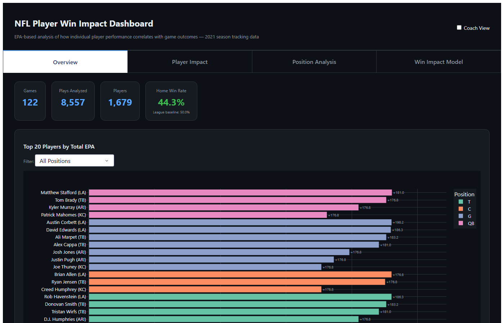

# NFL Player Win Impact Dashboard

An EPA-based analytics tool built on the 2021 NFL Big Data Bowl tracking dataset that quantifies how individual player performance drives game outcomes across all 1,679 players and 8,557 plays from the first 8 weeks of the 2021 season. The dashboard runs a gradient-boosting Expected Points model and logistic regression to surface which stats — pressures generated, EPA per play, times beaten — most predict winning, then presents the findings in four interactive tabs designed for both analysts and coaching staff.

---



---

## the live url

link: https://nfl-player-win-impact.onrender.com

## Live Demo

> **To run a public live demo**, start the dashboard locally then expose it with [ngrok](https://ngrok.com/download):
>
> ```bash
> # Terminal 1 — start the dashboard
> python src/dashboard.py
>
> # Terminal 2 — create a public URL (requires free ngrok account)
> ngrok http 8050
> ```
>
> ngrok will print a public HTTPS URL (e.g. `https://xxxx.ngrok-free.app`) that anyone can open in a browser for the duration of your session.

**Local URL:** `http://127.0.0.1:8050`

---

## Setup

**Requirements:** Python 3.9+

```bash
pip install pandas numpy scikit-learn plotly dash
```

```bash
# Step 1 — build the EPA pipeline (runs once, ~2 min)
python src/compute_epa.py

# Step 2 — launch the dashboard
python src/dashboard.py
```

---

## What's Inside

| Tab | Purpose |
|---|---|
| **Overview** | Top 20 players by EPA, all-32-team win rates, play impact distribution |
| **Player Impact** | Per-player stat cards with percentile rank, game-by-game EPA chart, scouting radar vs position average. Compare any two players side by side. |
| **Position Analysis** | EPA vs Win Rate bubble chart with quadrant labels, position filter, player search with zoom, top 5 per position |
| **Win Impact Model** | Feature importance, win rate by stat level, interactive win probability calculator |

Toggle **Coach View** in the top-right corner to switch all labels from statistical terminology to plain English.

---

## Data

Source: [NFL Big Data Bowl Regional Event Data](https://github.com/ThompsonJamesBliss/nfl-big-data-bowl-regional-event-data) — `games.csv`, `players.csv`, `plays.csv`, `pffScoutingData.csv`, and 122 per-game tracking files (~833 MB total).


